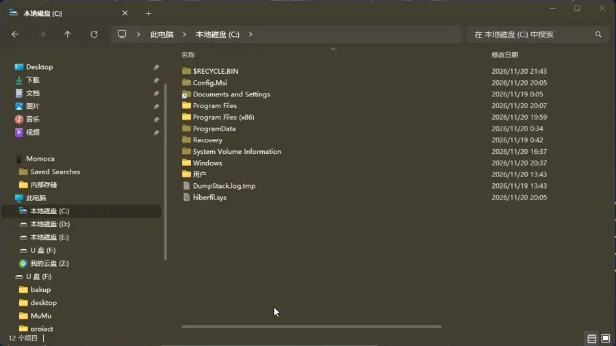

# Windows 11 File Explorer Styler Color Fix

让 Windows 11 文件资源管理器的窗口背景跟随系统强调色，并让目录树、文件列表和分组标题使用协调的悬停与选中颜色。此 Windhawk Mod 基于 m417z 的 Windows 11 File Explorer Styler 1.7.2，保留上游布局主题和自定义 XAML 样式。

当前版本 **1.7.2.12**，目标为 **Windows 11 x64** 的 `explorer.exe`。本项目提供可在 Windhawk 中编译的[单文件 C++ 源码](windows-11-file-explorer-styler-color-fix.wh.cpp)。

## 演示视频

[](media/demo.mp4)

[打开原始视频（36 秒，含声音）](media/demo.mp4)

## 安装

1. 安装 [Windhawk](https://windhawk.net/)，打开上面的源码文件，使用 GitHub 的 **Download raw file** 下载到本地。
2. 如果已启用官方 **Windows 11 File Explorer Styler** 或早期 **Local Accent** 版，请记下当前主题和自定义样式，并停用旧版。不同 Mod ID 各自保存设置。
3. 使用带有 `windhawk-cli.exe` 的 Windhawk 版本，在下载源码的目录打开 PowerShell，运行下面的命令。将第一行改成自己的 Windhawk 安装目录。

```powershell
$windhawk = 'C:\Program Files\Windhawk\windhawk-cli.exe'
& $windhawk mod install --file .\windows-11-file-explorer-styler-color-fix.wh.cpp
& $windhawk mod list
```

安装程序会在本机编译。列表中应出现已启用的 **Windows 11 File Explorer Styler Color Fix**。Windhawk 为本地安装添加 `local@` 前缀，完整安装 ID 为 `local@windows-11-file-explorer-styler-color-fix`。

**通过界面安装**也可以：在 Windhawk 中选择创建新 Mod，打开编辑器，将下载的 `.wh.cpp` 全文替换模板，保存并编译，然后在已安装 Mod 列表确认启用。

## 配置

在 Mod 的 **Settings** 中选择布局和背景效果，然后保存并打开资源管理器。

| 设置 | 用途 |
| --- | --- |
| Theme | 新装默认使用 `Minimal Explorer11`。也可选 `NoCommandBar` 或其他上游主题。 |
| Translucent background effect | 选择 `System accent Acrylic (solid when inactive)` 启用本分支的强调色效果。 |
| Translucent background effect region | 选择 `Entire window`，让背景延伸到文件列表、目录树和状态栏。 |
| Active accent tint opacity | 范围 0–100，新装默认 70。值越低，底层模糊背景越明显；50 表示半透明着色，最终显示的颜色会受背景影响。 |

强调色取自 Windows **设置 → 个性化 → 颜色 → 主题色**。可以先选一个容易辨认的颜色，然后分别观察窗口激活、失焦和列表悬停时的效果。

## 相对上游的改进

- **窗口随系统换色。** 激活时直接以当前 Windows 强调色为 Acrylic 着色，失焦时根据深浅模式取强调色变体，与中性色混合得到不透明背景。
- **左右两侧使用一致的交互颜色。** 目录树和文件列表的悬停、选中、失焦选中和按住状态使用不同深浅的半透明底色。点击空白清除选择后，再移回仍有焦点框的文件，行内使用悬停色并保留系统焦点边线。
- **分组标题跟随背景。** “此电脑”的“设备和驱动器”“网络位置”等分组标题也使用主题色系的悬停反馈。
- **换色和窗口恢复。** 连续的系统主题通知合并后再应用材质，并重绘窗口与子控件。窗口从最小化恢复时会刷新背景。若可见的前台资源管理器窗口整窗透明度卡在 0，Mod 会将其恢复到 255，Acrylic 的着色透明度仍由上面的设置控制。

## 更新与回退

更新时下载新源码，使用相同的安装命令重新编译。停用本地版可以在 Windhawk 界面操作，也可以运行：

```powershell
& $windhawk mod disable local@windows-11-file-explorer-styler-color-fix
```

如需切回官方版，停用本地版后，在 Windhawk 中重新启用官方 Styler。遇到布局错位、残留灰条或窗口透明时，请在 [Issues](https://github.com/momoca/windows-11-file-explorer-styler-color-fix/issues) 附上 Windows 构建号、Windhawk 和 Mod 版本、布局主题以及复现步骤。对于偶发透明问题，请注明是否发生在换色、失焦或最小化恢复之后。

## 上游与许可

原作者为 **m417z**，本仓库维护 Color Fix 修改。源码沿用 **GNU GPL v3.0**。布局主题及其贡献者信息见源码内置说明。[上游源码基线](https://github.com/ramensoftware/windhawk-mods/blob/5ba8c1e52edb9297bf2cdd6dbf4234c6e9bd6d33/mods/windows-11-file-explorer-styler.wh.cpp) · [许可证全文](LICENSE)
